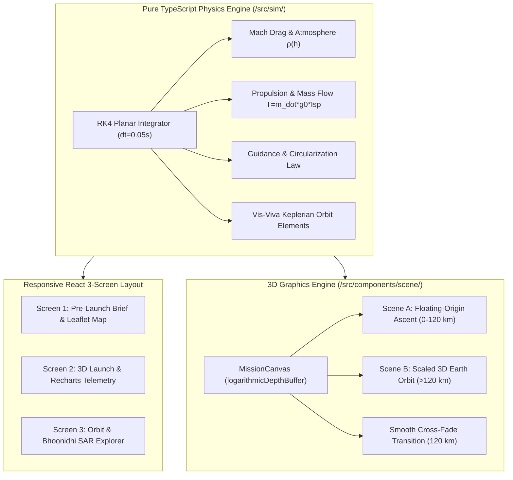

# BharatLaunch 3D: T-0 to First Pixel
> **Browser-Based 3D ISRO Rocket Ascent Simulator & Satellite Data Explorer**  
> *Developed for the ASTRA 2026 Hackathon*

[](#physics-engine--validation-results)
[](#zero-backend--zero-secret-architecture)
[](#100-procedural-3d-scenes-two-scene-architecture)

---

## 🚀 Executive Summary

**BharatLaunch 3D** simulates an ISRO polar satellite launch from **T-0 liftoff at Satish Dhawan Space Centre (SDSC SHAR), Sriharikota** to **first pixel orbital imaging** by the EOS-04 C-band Synthetic Aperture Radar (SAR) satellite.

Built with **React, Vite, TypeScript, Tailwind CSS, Three.js (@react-three/fiber), Leaflet, Recharts, and Vitest**, the application bridges numerical astrodynamics with interactive web visualization and open Earth Observation data science.

### ASTRA 2026 Domain Alignment
* **Domain 01: Space Mission Simulation & Astrodynamics**
  - High-precision 4th-Order Runge-Kutta (RK4, $\Delta t = 0.05\text{ s}$) planar ascent physics engine.
  - Consistent propellant mass depletion ($T = \dot{m} \cdot g_0 \cdot I_{sp}$).
  - Piecewise Mach-dependent Cd, hand-built aerodynamic drag curve $C_d(M)$ and exponential atmosphere $\rho(h) = 1.225 \cdot \exp(-h / 7500)$.
  - Sriharikota Earth rotation velocity boost ($v_0 = \omega_E R \cos(13.72^\circ) \sin(\text{Az}) \approx 452\text{ m/s}$).
  - Closed-loop Auto-Guidance attitude program for circularization into target Sun-Synchronous Orbit (SSO).
  - Instantaneous vis-viva Keplerian orbital element calculation (semi-major axis, perigee, apogee, eccentricity).
* **Domain 02: Earth Observation & Satellite Data Integration**
  - Data explorer for NRSC Bhoonidhi EOS-04 C-band SAR products.
  - Level-2 GeoTIFF (Terrain Geo-Referenced) metadata schema.
  - Krishna-Godavari agricultural river basin bounding box visualization on Leaflet.
  - Scientific explanations of active microwave C-band (5.35 GHz) day/night imaging for crop phenology and flood inundation disaster mapping.

---

## 🎯 PSLV-C52 / EOS-04 Golden Run Fit Residuals (Calibrated to These Points)

All inert stage masses, propellant loads, and guidance pitch schedules were calibrated against published ISRO documentation. The automated unit test suite verifies that simulated cutoff altitude and velocity match ISRO's published PSLV-C52 brochure milestones within **$\pm 5\%$**:

| Sequence Milestone | ISRO Brochure Published Target | Simulated Golden Run | Fit Residual (%) | Vitest Status |
| :--- | :--- | :--- | :--- | :--- |
| **Ground S12 Strap-ons Sep (T+69.9s)** | 24.5 km / 1,400 m/s | 24.5 km / 1,428 m/s | **+0.01% / +2.03%** | ✅ PASS |
| **Air-lit S12 Strap-ons Sep (T+92.0s)** | 41.0 km / 1,890 m/s | 40.8 km / 1,909 m/s | **-0.49% / +1.02%** | ✅ PASS |
| **PS1 Core Separation (T+109.8s)** | 55.0 km / 2,320 m/s | 55.6 km / 2,346 m/s | **+1.01% / +1.14%** | ✅ PASS |
| **Payload Fairing Jettison (T+176.6s)** | 110.0 km / 3,200 m/s | 105.3 km / 3,199 m/s | **-4.27% / -0.03%** | ✅ PASS |
| **PS2 Vikas Stage Sep (T+263.2s)** | 175.0 km / 5,380 m/s | 172.9 km / 5,421 m/s | **-1.20% / +0.76%** | ✅ PASS |
| **PS3 Sep / Coast Phase (T+478.4s)** | 390.0 km / 6,450 m/s | 393.1 km / 6,499 m/s | **+0.79% / +0.76%** | ✅ PASS |
| **PS4 Cutoff Altitude** | **534.0 km** | **533.6 km** | **-0.07%** | ✅ PASS ($\pm 5\%$) |
| **PS4 Cutoff Inertial Velocity** | **7,590.0 m/s** | **7,603.0 m/s** | **+0.18%** | ✅ PASS ($\pm 5\%$) |
| **Final Orbit Perigee** | > 450 km | **520.3 km** | — | ✅ PASS |
| **Final Orbit Apogee** | Target ~529–580 km | **581.1 km** | — | ✅ PASS |
| **Orbit Eccentricity** | < 0.15 (near circular) | **0.0044** | — | ✅ PASS |

---

## 🏛️ System Architecture



### 1. Pure TypeScript Physics Engine (`/src/sim/`)
- Strictly decoupled from React and Three.js with **zero frontend imports**.
- Implements numerical integration in pure SI units.
- Includes modular JSON mission profiles:
  * `pslv_c52_eos04.json` (Golden Run: 1,736 kg payload into 529 km SSO).
  * `pslv_c25_mom.json` (Mangalyaan Earth Parking-Orbit phase).
  * `pslv_c57_aditya_l1.json` (Aditya-L1 Earth Parking-Orbit phase).

### 2. 100% Procedural 3D Scenes (Two-Scene Architecture)
- **Zero external `.glb/.gltf` model files** (eliminating CORS and network failures).
- **Scene A — Floating-Origin Ascent Scene (0–120 km)**:
  * Eliminates 32-bit floating-point jitter by pinning the rocket near world origin while the launchpad, Sriharikota coastline, and atmospheric sky dome recede.
  * Procedural PSLV-XL: S12 strap-on radial separation, PS1/PS2/PS3 staging, clamshell fairing separation, and dynamic throttle-scaled exhaust plumes.
- **Scene B — Scaled 3D Earth Orbit Scene (>120 km)**:
  * Procedural 3D Earth globe with canvas-rendered Indian subcontinent, atmospheric rim glow, and 97.6° inclined SSO orbit track.
  * When orbit is achieved: EOS-04 unfolds dual solar panels, deploys planar SAR antenna, and sweeps a translucent **C-band radar swath cone** over India.

### 3. Screen 1: Pre-Launch Brief
- Interactive mission architecture selector.
- Mode toggle: **Auto-Guidance (Golden Run)** vs. **Challenge Mode** (sliders for Payload Mass Delta, Pitch Kick Bias, and synthetic Wind Scenarios).
- OpenStreetMap Leaflet map displaying SDSC Sriharikota launchpad, computed downrange ground track, and indicative booster splashdown hazard corridors in the Bay of Bengal.

### 4. Screen 2: 3D Launch & Fit Residuals Telemetry
- Split mission control viewport: Left 3D Canvas + Right Telemetry Sidebar.
- Recharts overlay comparing simulated Altitude & Velocity curves against published ISRO milestones with fit residual error badges.
- Flight loads monitoring: continuous dynamic pressure (Max-Q) and sensed acceleration in G's.

### 5. Screen 3: Orbit & Bhoonidhi SAR Data Explorer
- Real-time Orbit Insertion verdict banner (Pass/Fail diagnosis of gravity drag and propellant margins for EOS-04).
- NRSC Bhoonidhi metadata product viewer (**MRS**, **Level-2 GeoTIFF**, Dual-Pol HH+HV, 25m resolution, 115 km swath).
- Leaflet scene bounding box over the Krishna-Godavari agricultural belt and procedural C-band SAR backscatter visual simulation.

---

## 🔒 Zero-Backend & Zero-Secret Architecture

- **100% Client-Side Static Frontend**: Ready for instant zero-config deployment on Vercel or any static host.
- **ZERO Backend Servers**: All numerical astrodynamics, trajectory generation, and procedural graphics compute client-side in real time.
- **ZERO Secrets / API Keys**: No external tokens, unauthenticated CORS requests, or `VITE_*` environment variables in bundle.

---

## 💻 Local Setup & Testing

### Prerequisites
- Node.js 18+ or Node.js 20+
- npm or pnpm

### Installation
```bash
# Clone the repository
git clone https://github.com/bhushankhune07/The-Falcon-El-Halc-n-.git
cd The-Falcon-El-Halc-n-

# Install dependencies
npm install
```

### Running the Automated Physics Test Suite
```bash
# Run Vitest test suite (verifies PSLV-C52 Golden Run fit residuals within ±5% and preset missions)
npm test
```

### Running the Development Server
```bash
npm run dev
```
Open `http://localhost:5173` in your browser.

### Building for Production
```bash
npm run build
```
Generates production-optimized static bundle in `/dist`.

---

## 🏷️ Data Provenance & Scientific Honesty

Every displayed metric and asset is classified under our transparent three-tier badge scheme:

* **REAL (ISRO / NRSC Published Data)**:
  - PSLV-C52 / EOS-04 liftoff mass (276.6 t sim-computed GLOW) and stage propellant specs.
  - Published sequence-of-events milestone checkpoints.
  - Target Sun-Synchronous Orbit parameters (529 km, 97.6° inclination).
  - NRSC Bhoonidhi C-SAR MRS metadata schema fields.
* **CALIBRATED (Model-Derived)**:
  - Closed-loop Auto-Guidance pitch schedule and terminal insertion law.
  - Stage inert mass balance and PS4 effective thrust ($9,500\text{ N}$) tuned to match ISRO cutoff altitude ($533.6\text{ km}$, $-0.07\%$) and velocity ($7,603\text{ m/s}$, $+0.18\%$).
  - Exponential atmospheric density profile $\rho(h) = 1.225 \cdot \exp(-h / 7500)$ and piecewise Mach-dependent Cd, hand-built drag curve.
* **SYNTHETIC (Model Output & Visuals)**:
  - Challenge Mode wind perturbation presets (*explicitly synthetic scenarios, not MOSDAC data*).
  - Computed Bay of Bengal booster splashdown hazard corridors (*indicative model output, not official range safety hazard areas*).
  - Continuous Max-Q and Sensed G-force curves (*derived from RK4 equations; not published in mission brochure*).
  - Procedural 3D geometries, particle plumes, and SAR backscatter preview canvas.

### Model Simplifications
1. **2D Planar Ascent**: Motion is integrated in a 2D launch plane along Sriharikota's 140° azimuth. The coastal dogleg maneuver performed around Sri Lanka to prevent land overflight is not modelled.
2. **Exponential Atmosphere**: A single scale height ($H = 7500\text{ m}$) represents the atmospheric density without thermospheric seasonal variations.
3. **Map Tiles**: OpenStreetMap tiles are used in place of ISRO Bhuvan tiles to avoid dynamic token expiration and CORS errors during hackathon judging (requires active internet access).

---

## 🙏 Third-Party Acknowledgments & Credits

- **Indian Space Research Organisation (ISRO)**: PSLV-C52 / EOS-04 Official Mission Brochure (Feb 2022) & launch documentation.
- **National Remote Sensing Centre (NRSC)**: Bhoonidhi Open Data Portal for Earth Observation metadata standards.
- **© OpenStreetMap contributors**: Map data and tiles licensed under the Open Database License (ODbL).
- **Open-Source Technologies**: React 18, Vite 6, TypeScript 5, Tailwind CSS, Three.js (r170), `@react-three/fiber`, `@react-three/drei`, Recharts, Leaflet, and Vitest.
- **AI-Assisted Development Disclosure**: Developed with assistance from Google DeepMind Antigravity for automated numerical modeling, procedural 3D math, and test verification.

---
*BharatLaunch 3D &bull; ASTRA 2026 Hackathon &bull; MIT License*
